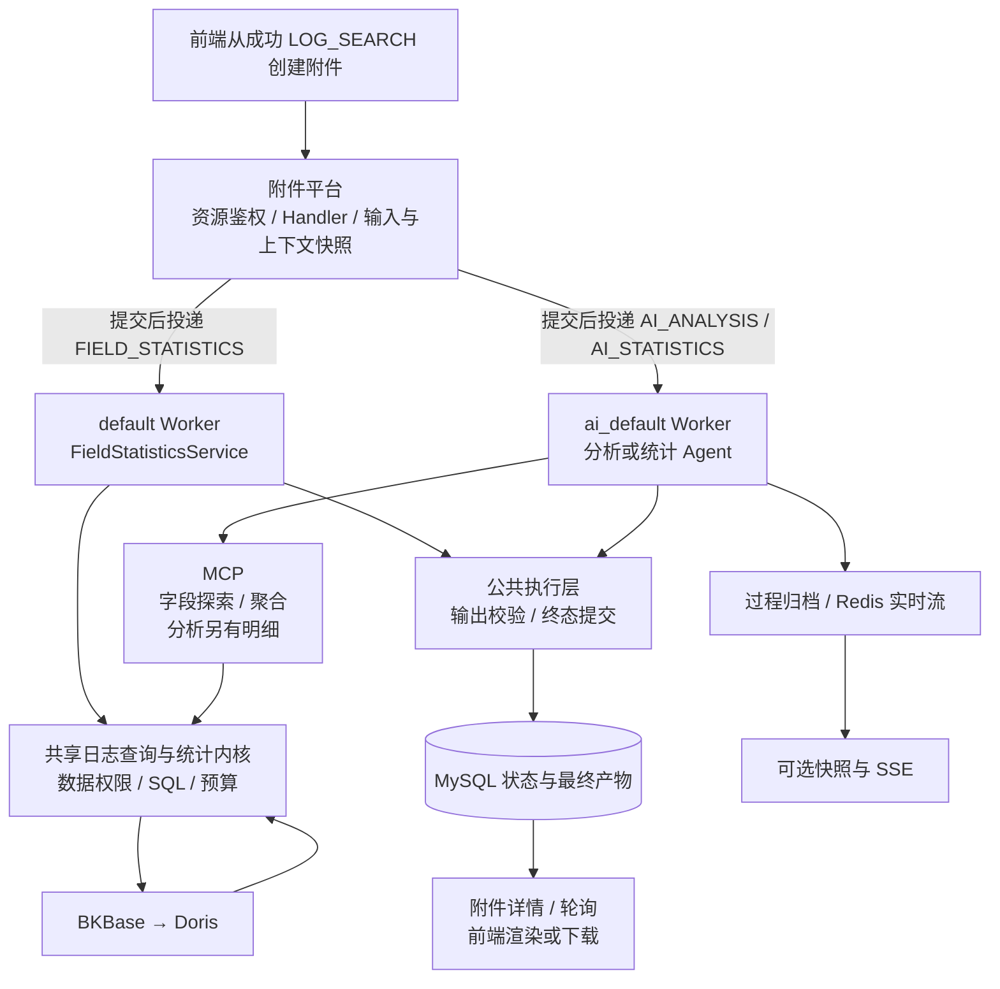

# AI 助手模块功能与架构设计

平台负责会话、消息、附件及执行生命周期；日志查询和统计属于 query 领域。本文保留模块边界与核心执行规则，接口接入见[公共联调指南](frontend_integration.md)、[分析报告联调](frontend_log_analysis.md)和[统计联调](frontend_statistics.md)。

## 1. 功能与职责

| 模块 | 职责 | 主要入口 |
| --- | --- | --- |
| 会话、消息与侧栏 | 用户及 Scope 隔离、检索交互、来源消息 | `views.py`、`services/conversation.py`、`handlers/audit_search.py` |
| 附件平台 | 创建、快照、投递、重试、终态及产物保存 | `services/attachment.py`、`services/attachment_execution.py`、`tasks/base.py` |
| Handler | 注册业务类型，校验输入，准备可信上下文 | `handlers/`、`schemas/` |
| 业务 Task | 执行领域服务或 Agent，返回业务结果 | `tasks/audit_analysis.py`、`tasks/audit_statistics.py` |
| 流服务 | 接入 ui-stream 通用流处理，管理审计归档、权限与恢复 | `streaming/`、`services/attachment_stream.py` |
| 日志查询 | 字段探索、脱敏明细、聚合及程序统计 | `../query/ai_assistant/log_tools/` |

三类附件都从当前用户的成功 LOG_SEARCH 创建，固化来源条件和业务输入；同一来源可创建多个独立附件。

| 类型 | 执行方式 | 查询方式 | 最终产物 |
| --- | --- | --- | --- |
| AI_ANALYSIS | `ai_default`，调用 `bp-ai-log-analyse` | 字段探索、明细与聚合 MCP | `output_data.markdown`，可编辑和导出 Markdown/PDF |
| FIELD_STATISTICS | `default`，调用 FieldStatisticsService | 直接复用统计领域服务，不经 MCP HTTP | 概览、分布、时序、可选数值摘要 |
| AI_STATISTICS | `ai_default`，调用 `bp-ai-log-stats` | 字段探索与聚合 MCP | `output_data.content`，标签内未解析原文 |

程序统计默认使用完整来源范围，也可提交当前附件独立的完整 condition，不能以预览行代替。AI 统计将来源范围作为初始上下文，Agent 可按需求调整有权限的实际查询范围。Agent 输出协议与前端渲染由前端及 skills 协同维护。

## 2. 权限分层

| 层次 | 负责什么 | 为何仍需要 |
| --- | --- | --- |
| HTTP Permission | 从请求或本人资源 UID 解析会话 Scope，检查访问权限 | 确定用户能否访问该会话资源；有 UID 不要求重复传 Scope |
| Serializer / Resource | 校验参数、类型和请求语义 | 参数合法与资源有权是两件事，不在此重复调用 IAM |
| 平台 Service | 限定本人、未删除资源；写入时检查来源、目标、锚点同 Scope | 保证归属及并发写入一致性，不重复入口鉴权 |
| 跨范围列表 | 枚举当前有权限的场景或系统后过滤 | cross 是有权资源的集合，不代表获得任意 Scope 权限 |
| 查询领域 | 按实际用户校验查询系统及敏感字段，把授权条件写入 SQL | 会话归属不代替日志数据权限；AI 调整查询范围后仍须鉴权 |

会话、分组创建时绑定具体 scene/system，消息和附件继承会话归属。移动的来源、目标和锚点必须同 Scope；这是写入一致性约束。内部调用由调用入口承担授权，不能绕过公开入口的权限层。

## 3. 执行与结果链路

创建时 Handler 校验来源和输入，并固化执行用户、租户、时区及检索条件，客户端不能覆盖这些可信上下文。平台在事务内保存 PROCESSING 和 task_id，提交后再投递，避免 Worker 读到尚未提交的对象。Worker 加载快照并复核归属及会话有效性；不重新用已编辑的来源消息覆盖快照。

业务 Task 只处理查询或 Agent 调用，公共基类负责快照与输出校验、错误映射和终态提交。附件保存大产物，Celery 只返回轻量状态；新增业务从 Handler/Task 接入，不复制生命周期逻辑。实现与接入示例见[Handler 接入指南](handler_integration.md)。

终态通过状态与 task_id 条件更新，拒绝旧任务覆盖新执行；业务调用不保证 exactly-once。临时故障有界自动重试，业务超时、异常和长期 PROCESSING 巡检负责失败收敛。AI 任务共用 ai_default workload，下游限流由公共 Agent Client 按 Agent Code 在 Redis 中控制。

归属检查、终态条件更新和查询鉴权分别防止写入已删除会话、旧任务覆盖新任务、实时权限变化后继续访问日志。它们与 HTTP 入口鉴权目的不同。巡检阈值需覆盖业务执行及重试等待时间，否则正常长任务会被提前判失败；维护入口为 `services/reconciliation.py`。

异步附件 SUCCESS/FAILED 均可人工重试：保留 UID；未传 input_data 复用原快照，传入完整输入则复用创建校验/prepare并原子替换输入和上下文，清空旧产物、错误、反馈及过程，生成新 task_id；新 Worker 建立新 execution_id。修改条件只影响当前附件；需要保留旧结果时另建附件。Message 重试仍只允许 FAILED + ASYNC。

## 4. 查询与产物边界

程序统计和聚合 MCP 共用[日志查询与统计内核](../../query/ai_assistant/log_tools/README.md)，AUTO 统一按完整范围从月到分钟选择首个达到桶数阈值的粒度（默认12，后端可配置），容量独立检查。响应按消费者组织：程序返回全类别和完整轴，MCP默认Top10和稀疏桶。二者支持自然月和value_label，原始typed值不变。字段目录用于发现和提示，不作为自定义路径必须存在的前置条件。

AI 分析保存完整闭合 assistant 报告；AI 统计从最后闭合 assistant 消息中提取唯一、顺序正确、非空的标签块。后端不解析 JSON/ECharts。标签协议失败走任务失败/重试；标签有效但图表不可渲染不改变附件成功状态，前端需单独处理渲染错误。统计 Agent 不提供明细检索，需要明细证据的需求使用分析 Agent。报告链路见[日志分析接入](log_analysis.md)。

MySQL 是最终状态和产物事实源，Redis 只提供实时过程。所有异步附件都可轮询详情；AI 可选快照＋SSE，流结束或重连后重新读取详情。完整流恢复语义见[流式设计](../streaming/README.md)。

## 5. 扩展与验证

新增业务类型从[Handler 接入](handler_integration.md)开始；共有生命周期规则放平台基类，查询规则放 query 领域，图表协议不进入任务基类。排障和指标边界见[可观测性](observability.md)。

测试分别覆盖协议/权限、SQL与统计口径、任务终态/重试及流恢复。special 使用真实 Worker、MySQL、Redis和RabbitMQ，部分外部系统仍用替身。部署验收需要沿页面操作核对实际查询数值、图表渲染、持久化恢复和下载文件；接口 SUCCESS 不代替这些验证。环境版本、E2E结论及问题跟进保留在本地专题，本文不维护验收状态。
