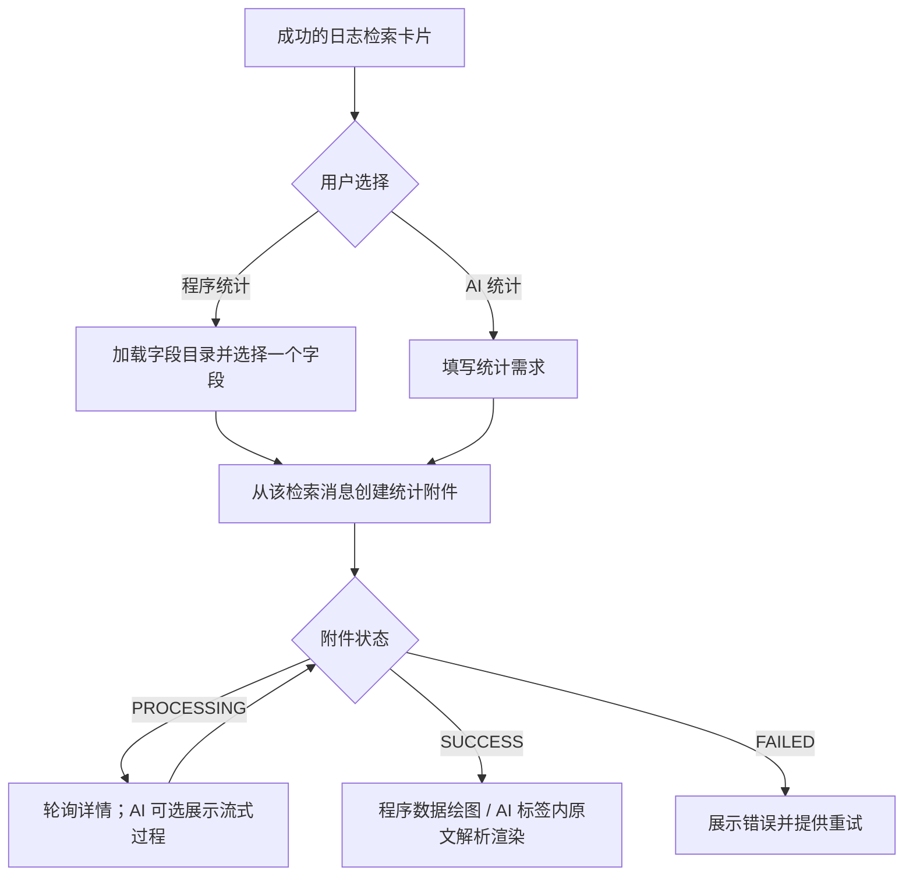
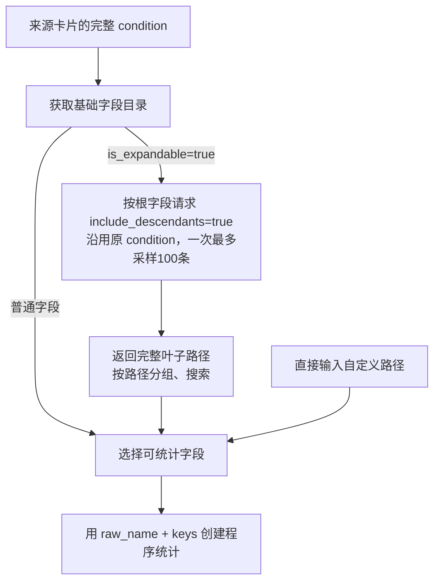
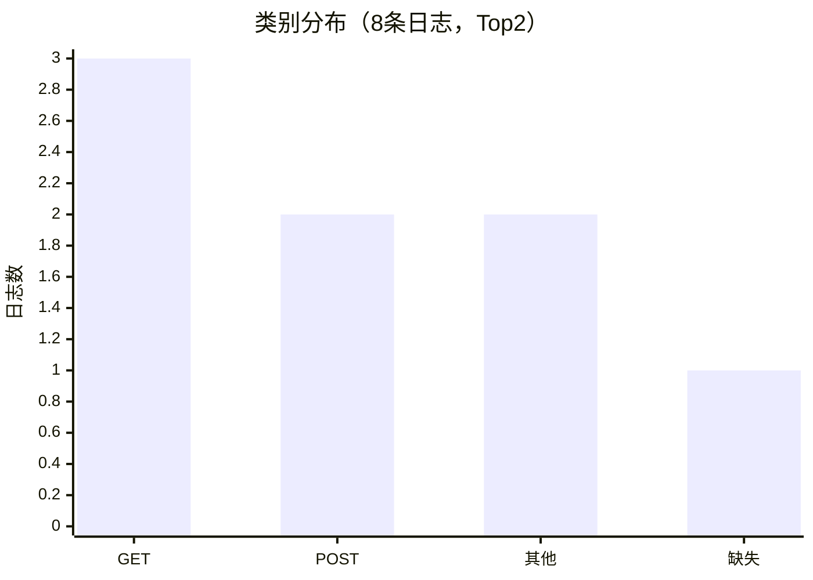
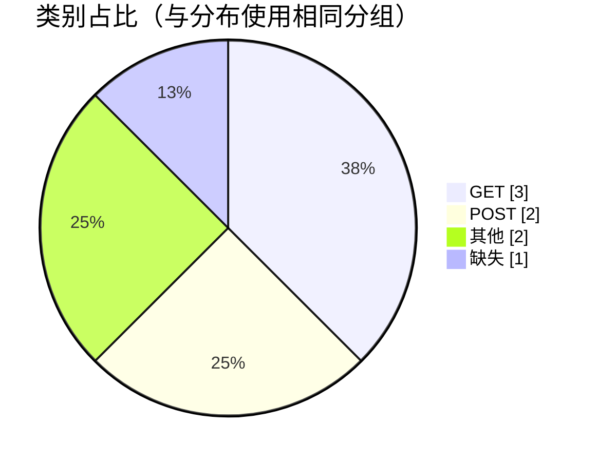
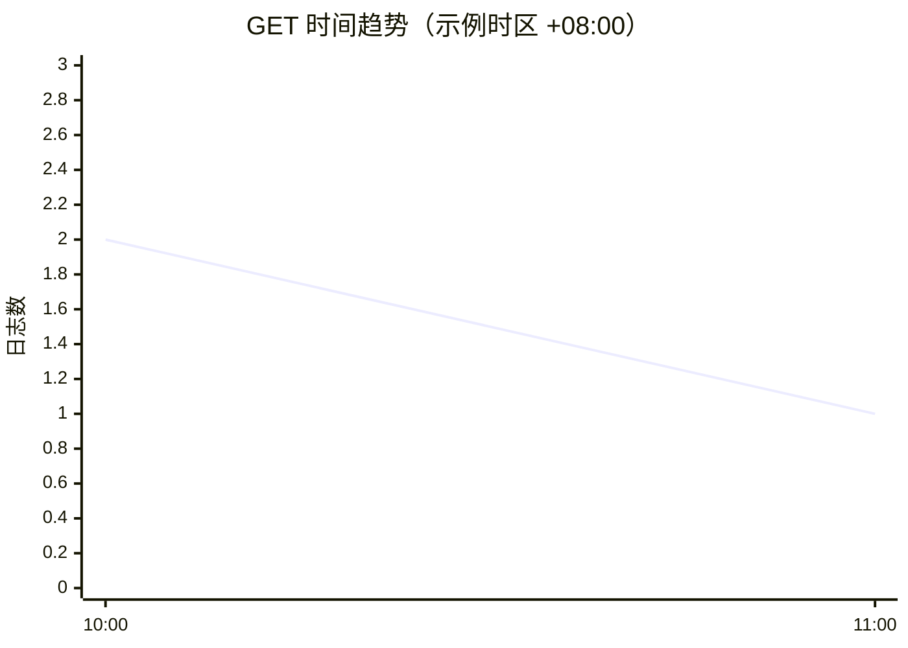
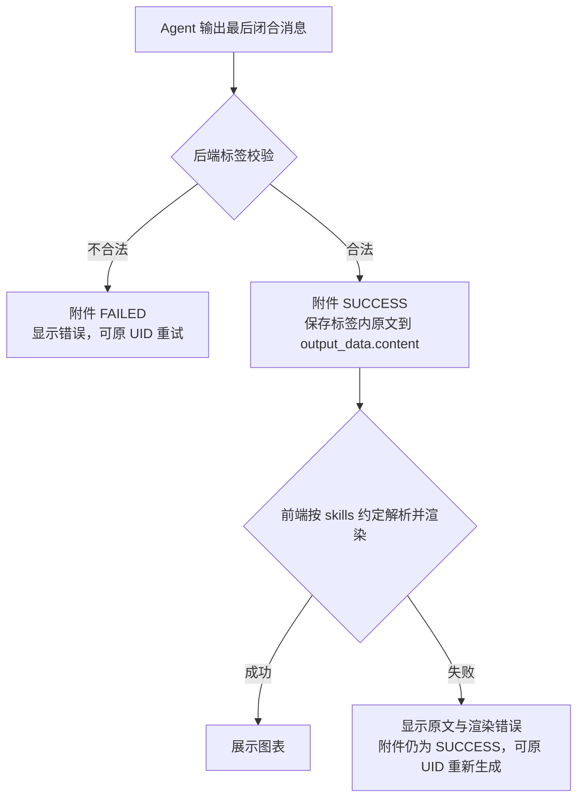

# AI 与程序统计前端联调指南

本文按页面操作串联统计能力：从哪张检索卡片进入、何时调用接口、如何等待结果，以及重新打开和重试时如何恢复。具体请求参数、字段类型、枚举、限制和请求响应样例，请在当前联调环境的 `/swagger/` 查看；机器协议为 `/api/schema/`。下文保留的字段用于说明接口之间的关联和页面行为。

会话、消息、认证、公共响应处理及 SSE 实现见[公共联调指南](frontend_integration.md)。本文只说明稳定的联调链路和渲染语义，环境进展与验收记录不在此维护。

## 1. 先看完整用户路径



| 页面决策 | 程序统计 | AI 统计 |
| --- | --- | --- |
| 用户提供什么 | 选择一个字段，可调整类别数和时间粒度 | 填写统计需求 |
| 统计什么范围 | 来源成功检索的完整范围 | 来源为初始上下文，Agent 可按需求调整 |
| 如何等待 | 轮询附件详情 | 同样可轮询；需要过程时选用 SSE |
| 成功后展示什么 | 后端固定统计包，由前端绘图 | `output_data.content` 为指定标签内未解析原文，由前端解析渲染 |

两类统计当前均异步执行。创建后按返回的 status 进入等待或终态，不假设响应已经包含 output_data。

| attachment_type | input_data | SUCCESS 时的 output_data |
| --- | --- | --- |
| FIELD_STATISTICS | field，可选 top_n/interval | 固定统计包：overview/distribution/time_series/numeric_summary |
| AI_STATISTICS | instruction | Agent 最后闭合消息中指定标签内的未解析原文 |

Swagger 的嵌套 oneOf 不会自动关联外层 attachment_type；前端按此映射选择输入和解释输出。
程序统计与 MCP 类别聚合默认 Top10，可显式调整；部署预算可收紧上限，以后端校验为准。已有附件保留创建时的参数。
程序统计固定包补齐时间轴；MCP 返回稀疏时间桶，两者共享统计口径和四位小数规则，按各自消费者组织响应。

统计是来源消息上的附件，不会新增消息。同一检索卡片可以有多个统计附件，每个附件独立保存、展示和重试。

## 2. 进入统计面板：先绑定来源卡片

从当前用户的成功 LOG_SEARCH 卡片进入，保存**该卡片的消息 UID**，后续创建请求始终使用它，不用“最新一条消息”推测来源。程序统计针对完整检索范围，不针对卡片预览行。

页面筛选条件修改但尚未执行时，旧卡片仍代表旧查询。程序统计需要按新范围计算时，应先完成新检索，再从新卡片进入；AI 统计可以从原卡片提交新的统计指令，由 Agent 按需求调整有权限的查询范围，附件仍归属原卡片。打开历史卡片时，如果页面只有摘要，先读取消息详情；字段探索使用该消息 `input_data.condition` 中的完整条件，不用当前条件编辑器中的草稿替换。

程序统计进入字段选择步骤；AI 统计直接进入需求输入，不要求前端先探索字段或调用统计工具。

## 3. 程序统计：选字段 → 创建 → 展示

### 选择字段

打开字段选择器时，调用 `POST /api/v1/query/namespaces/{namespace}/collector_query/field_metadata/`，namespace 沿用页面已有的租户上下文，并使用来源消息的完整检索条件。此处是 Web 接口，前端无需接 MCP 网关。

初次只传来源消息的完整 `condition`，获取全部基础字段。按 `is_expandable` 分组：例如 extend_data、instance_data 等 JSON 根字段可以展开。前端分别对这些根字段发送二次请求，传原 `condition`、`parent_field` 和 `include_descendants=true`。后端每次只采样一批最多100条日志，仅返回内置声明与这批样本合并后的叶子字段完整路径，不包含父项和中间对象，不需要再逐层请求。



例如展开 extend_data 中的 a，请求增量参数为：

```json
{
  "parent_field": {"raw_name": "extend_data", "keys": ["a"]},
  "include_descendants": true
}
```

请求还须包含来源消息的 `condition`。采样中有 a.b.c、a.b.d 和 a.e 时，响应 `fields` 只包含这三个叶子，不包含 a、a.b，每项仍使用完整的 `field.raw_name` 与 `field.keys`。前端可按路径前缀建立分组、直接搜索叶子目录；提交统计时保留原字段引用，不把点号拼接结果当作 raw_name。

根目录及单层目录的 `is_expandable=true` 表示该字段可作为对象分组，前端可发起级联查询。级联响应仅包含叶子，`is_expandable=false`，直接用于选择器；选取操作仍参考 `statistics_supported`。数组作为叶子但不支持统计，不展开数组下标或元素键。空对象没有叶子，不返回；达到路径深度上限的对象不冒充叶子，`truncated=true` 提示发现不完整。

省略 `include_descendants` 时只返回直接子字段；Web 的递归模式不截断字段数量，MCP 仍逐层探索。`sample_summary.truncated=true` 表示发现可能不全；界面应标注“样本发现”，空目录不能解释为全范围不存在字段。`coverage` 只针对本次SQL返回的样本，不是完整范围覆盖率。加载失败留在选择器中重试，不创建统计附件；采样和响应预算以 Swagger 为准。

支持用户直接填写自定义字段路径，**无需先在目录中找到它**。例如 extend_data.a.b.c 提交为 `{"raw_name":"extend_data","keys":["a","b","c"]}`。根字段须是接口支持的日志列，keys 逐段传对象键；不能传任意SQL表达式或数组下标。单引号可直接传入，例如 `{"raw_name":"extend_data","keys":["parent'key","child''key"]}`；前端不做SQL转义或空白裁剪，其他路径限制见 Swagger。合法但不存在的路径可成功返回全缺失统计。创建/执行仍会校验实际权限和全范围类型；目录类型仅供提示。

不受支持的根字段或不合法路径在创建时返回参数错误，不创建附件。展示接口提供的字段错误并保留输入，错误结构与样例见 Swagger。自定义对象键仍须归属已有日志列，例如 `extend_data` 下的 a；不能把业务名称 `event_data` 当作任意新增日志列。

目录 `options` 沿用原枚举展示，只是提示，不限制实际输入值。例如结果码 -1 只匹配真实 -1，不能用“其他=-1”替代非零条件；具体过滤方式见检索接口 Swagger。

### 确认并创建

用户确认字段后，调用 `POST /api/v1/ai_assistant/messages/{searchMessageUid}/attachments/`，类型选 FIELD_STATISTICS，业务输入使用选中的字段及需要调整的统计选项。无需让用户再选择统计类型，后端决定是否增加数值摘要；参数默认值、范围与样例见 Swagger。

请求期间禁用本次提交，失败时保留已选字段和选项。成功取得附件 UID 后，将其挂到来源卡片并打开结果面板，按第 5 节处理状态。创建响应也可能已经是终态，不要固定假设一定先进入轮询。

### 将成功产物映射到页面

详情 SUCCESS 后使用 `output_data`；前端不再查询 Doris 或汇总预览日志。`FIELD_STATISTICS` 返回语义数据包，由前端适配图表和表格。字段目录类型用于提示，最终布局以 `statistics_kind` 和 `numeric_summary` 为准；具体协议和样例见 Swagger。

`statistics_supported=true`、目录 `statistics_kind=null` 时仍可尝试统计。最终完整范围存在值均为原生数字，或字段是声明数值列时返回 NUMERIC；字符串数字不会自动转成数值。完整范围出现不支持的对象/数组时任务失败，不会静默改成类别统计。

比例按0～1返回四位小数，前端乘100后保留两位百分比；null显示“—”，很小的正比例可能舍入为0，是否有日志以计数为准。各组比例舍入后不要求合计恰好100%。数值摘要及聚合浮点指标同样返回四位小数，整数计数与类别原值不舍入。

| 响应字段 | 业务含义 | 推荐组件 | 前端处理规则 |
| --- | --- | --- | --- |
| `field` | 服务端确认的字段标识和展示名 | 标题、面包屑、字段标签 | 标题优先使用 `display_name`；请求和唯一定位保留 `raw_name + keys` |
| `statistics_kind` | `CATEGORICAL` 或 `NUMERIC` | 页面布局分支 | `NUMERIC` 显示数值摘要；`CATEGORICAL` 的 `numeric_summary` 必须视为 `null` |
| `overview` | 完整检索范围的存在性统计 | KPI 卡片、进度条、完整性环图 | `total_count` 是总日志数；`present_ratio` 是 0–1 小数，展示百分比时再乘 100 |
| `distribution.groups` | 全范围 TopN 类别及 `OTHER/MISSING` | 横向条形图、环形图、排行列表、分布表格 | 少量类别可用环图；类别较多优先横向条形图；使用 `kind` 判断合成组 |
| `time_series.bucket_starts` + `series` | 各类别按时间桶的数量变化 | 折线图、堆叠柱状图、堆叠面积图、趋势表格 | 横轴使用 `bucket_starts`；每条序列通过 `group_id` 找到类别；`counts` 与横轴等长 |
| `numeric_summary` | 完整范围的原生数值摘要 | 四个数值卡片、摘要表格 | 可展示 min/max/avg/median；`median` 必须标记为近似值；`valid_count` 是全范围有效数值数量；成功结果的 `conversion_failed_count` 当前固定为 0，不表示支持字符串数值转换 |
| `query_summary` | 实际执行范围、粒度和预算信息 | 查询信息条、筛选条件标签、折叠详情 | `returned_count` 是聚合 rows 数，不是日志总数；总数使用 `overview.total_count` |

#### 按 `statistics_kind` 选择布局

| 类型 | 默认布局 | 可以展示 | 不应做的事情 |
| --- | --- | --- | --- |
| `CATEGORICAL` | 概览 + 类别分布 + 时间趋势 | 用户名、操作类型、系统 ID、布尔值等的 TopN 和趋势 | 不显示数值摘要；不要把字符串数字当数值排序 |
| `NUMERIC` | 概览 + 数值摘要 + Top 值分布 + 时间趋势 | min/max/avg/median、原生数值 TopN 和趋势 | 不要根据 min/max/median 自行绘制箱线图；接口没有 Q1/Q3 |

#### `distribution.groups` 的渲染方式

`groups` 中每一项的 `value` 保留原始标量类型：

- `value_type=string`：按字符串展示和比较；即使内容是 `"120"`，也不能当作数字。
- `value_type=number`：按数字格式化，并可进行数值排序。
- `value_type=boolean`：按前端约定展示为“是/否”或 true/false。
- `kind=VALUE`：`value` 是真实日志值。
- `kind=OTHER`：TopN 之外的非缺失值总和，展示为“其他”。
- `kind=MISSING`：字段缺失或为 null，展示为“缺失”。

`OTHER` 和 `MISSING` 不占 `top_n` 名额，因此最终组数可能是 `top_n + 2`。真实值可能刚好叫“其他”或“缺失”，所以不能通过文字判断合成组。组件 key、图表关联均使用 `group_id`，不能使用格式化标签作为类别身份。同名时区分显示：数字 `120` 与字符串 `"120"` 可标注“120（数字）”“120（字符串）”；空字符串显示“空字符串”，真实值“其他”显示“其他（原始值）”。图表库若按名称操作图例，也要使用这些可区分的名称。

适配图表时：

```text
图例/标签：VALUE 用 value，OTHER/MISSING 用前端固定文案
数据值：使用 count
百分比：使用 ratio；total_count=0 时允许为 null
本份产物内的关联：使用 group_id，不解析其格式，不假设它跨重试或不同附件保持不变
```

分布与时序共用完整范围 TopN，保留额外的 OTHER/MISSING，不在各时间桶重新排名或重新计算比例。空结果是成功空态，不是执行失败。

#### `time_series` 的渲染方式

- `bucket_starts` 是按时间升序排列的完整横轴。
- `series[].group_id` 对应 `distribution.groups[].group_id`。
- `series[].counts[i]` 对应 `bucket_starts[i]`，长度必须一致。
- 一个类别时适合折线图；多个类别时适合多折线、堆叠柱状图或堆叠面积图。
- `requested_interval=AUTO` 时，展示粒度应使用 `effective_interval`，不能把 AUTO 当作实际时间单位。
- 时间轴和桶划分使用 `timezone`，前端不要再次按本地时区转换后重新分桶。

#### 一个结果怎样变成图表

下面只节选分布与时序，演示同一份数据怎样驱动排行图和趋势图，不是完整接口响应。Top2之外的 PUT/DELETE 共2条已合入 OTHER，缺失1条另列：

```json
{
  "distribution": {"groups": [
    {"group_id":"g1","kind":"VALUE","value_type":"string","value":"GET","count":3},
    {"group_id":"g2","kind":"VALUE","value_type":"string","value":"POST","count":2},
    {"group_id":"g3","kind":"OTHER","value_type":null,"value":null,"count":2},
    {"group_id":"g4","kind":"MISSING","value_type":null,"value":null,"count":1}
  ]},
  "time_series": {
    "bucket_starts":["2026-01-01T10:00:00+08:00","2026-01-01T11:00:00+08:00"],
    "series":[
      {"group_id":"g1","counts":[2,1]},
      {"group_id":"g2","counts":[1,1]},
      {"group_id":"g3","counts":[1,1]},
      {"group_id":"g4","counts":[1,0]}
    ]
  }
}
```

同一份示例数据可以显示为下面三种图。它们说明数据如何使用，实际页面样式由前端决定。

**类别分布：** 横轴为类别，纵轴直接使用 `groups[].count`。本例 Top2 之外仍展示“其他”和“缺失”。类别名称较长时可改成横向条形图。



**占比：** 环图或饼图使用同一组 `count`，并显示前端格式化后的百分比。本例 GET 为37.50%，其他为25.00%；接口的 `ratio` 是0～1的小数。下图标注计数、按计数划分扇区；页面上的百分比标签由前端格式化。



**时间趋势：** 横轴使用 `bucket_starts`，每个分组各取一条 `counts`。下图只画 GET，两个桶分别为2、1，合计为分布中的3条；其余分组按相同方式生成独立图例，缺失组第二个桶的0也保留。



趋势图按 `group_id` 找到分布中的同一类别，不能用展示名称关联。前端按上文规则实现 `formatGroupLabel`，再进行最小映射：

```javascript
const labels = new Map(output.distribution.groups.map(group => [group.group_id, formatGroupLabel(group)]));
const rankingData = output.distribution.groups.map(group => ({ name: labels.get(group.group_id), value: group.count }));
const trendOption = {
  xAxis: { type: 'category', data: output.time_series.bucket_starts },
  yAxis: { type: 'value' },
  series: output.time_series.series.map(series => ({
    id: series.group_id,
    name: labels.get(series.group_id),
    type: 'line',
    data: series.counts,
  })),
};
```

这是数据到组件的映射示意；图表样式由前端决定。`numeric_summary` 单独渲染摘要卡片，不根据均值或中位数推导接口未提供的箱线图、直方图。

## 4. AI 统计：填需求 → 创建 → 解析产物

用户填写统计需求后，使用相同创建附件接口，类型选 AI_STATISTICS，业务输入为 instruction。无需前端拼系统提示词、探索字段或调用聚合接口；后端和 Agent 完成查询执行。

提交失败保留需求草稿。创建成功保存附件 UID，挂到来源卡片，并按第 5 节选择仅看结果或展示过程。

SUCCESS 后读取 `output_data.content`。这是后端从 Agent 最后闭合消息中提取的指定标签内未解析原文，不保证是 JSON；后端只做标签切分，不执行 JSON/dict/list/ECharts 校验。图表解析与渲染由前端与 Agent skills 协同约定，解析失败时保留可查看的原文并提示重新生成。统计 Agent 只提供字段探索和聚合，不提供明细检索；需要查具体日志时使用 AI 分析入口。



标签协议失败（缺失、重复、空内文等）会使附件 FAILED，展示错误并提供重试。标签提取成功后的内容解析/渲染失败不改附件状态；前端可对 SUCCESS 附件调用同一 retry 接口重新生成。重试保留创建时的输入与上下文快照，清空旧产物、过程及反馈，本期不保留产物版本；新执行失败不恢复旧成功产物。中间文字和工具结果属于过程，不拼接成最终产物；单轮 AG-UI 事件仍原样归档，人工重试开始时清理上一轮归档并等待新 `execution_id`。AI 可以调整查询范围，因此不能直接把来源卡片范围标成图表实际范围；若页面需要展示实际范围，由前端与 Agent 输出约定提供。

## 5. 等待结果：轮询是通用方式，SSE 按需接入

所有异步附件都可以直接轮询 `GET /api/v1/ai_assistant/attachments/{uid}/`。`is_stream=true` 只表示支持过程订阅，不要求前端连接 SSE。

| 详情状态 | 页面下一步 |
| --- | --- |
| PROCESSING | 保持生成态，继续轮询；需要过程且支持流时，可切换为快照 + SSE |
| SUCCESS | 停止等待，按附件类型读取最终产物并渲染；渲染失败时可对原 UID 重新生成 |
| FAILED | 停止等待，展示 error_message 和重试入口 |

只看结果时无需快照、execution_id 或游标。按附件 UID 更新面板，合理设置轮询间隔，网络故障时退避；离开页面和进入终态时停止轮询。一次详情请求失败只重读，不重复创建附件，也不自行认定任务 FAILED。

选择展示 AI 生成过程时，链路为：**读快照 → 恢复已有过程 → 订阅后续 SSE → 收到 platform.stream_end → 重新读详情**。完整事件注册、游标和断线恢复使用[公共指南的流式章节](frontend_integration.md#流式附件先快照再增量最后详情)，不在本专题重复实现。

Agent 的消息结束或运行结束事件都不替代附件终态。最终结果始终读取详情；即便过程无法完整恢复，仍可以通过详情获得产物。

## 6. 重新打开、重试与改变需求

| 用户动作 | 调用衔接与页面行为 |
| --- | --- |
| 刷新页面或从原卡片重新打开 | 从消息附件摘要或附件列表找到 UID → 读取附件详情 → 终态展示结果，PROCESSING 恢复轮询或可选过程订阅；不重新创建 |
| 查看该卡片已有统计 | `GET /api/v1/ai_assistant/attachments/` 传 source_message_uid 和统计类型，无需重复 Scope；列表是摘要，点击后读详情 |
| 失败后原样重试 / 成功后重新生成 | `POST /api/v1/ai_assistant/attachments/{uid}/retry/` → 保留附件 UID，立即清空旧产物、错误、过程与反馈 → 按返回状态恢复等待 |
| 更换字段、统计选项或 AI 需求 | 从来源消息创建新附件，保留原结果；不能修改原附件 input_data 来重跑 |
| 更换程序统计范围 | 先完成新的检索，再从新消息创建附件 |
| 修改标题 | PATCH 原附件，成功后更新卡片和列表标题 |

按来源消息或会话恢复附件，只传 `source_message_uid` 或 `conversation_uid` 即可，例如 `GET /api/v1/ai_assistant/attachments/?source_message_uid={messageUid}&attachment_type=FIELD_STATISTICS&sort=-created_at`。后端根据本人资源的实际 Scope 校验权限；重复传入的 Scope 不会覆盖资源归属。两个 UID 同时传入时取交集。

未指定资源 UID 的完整附件列表才必传 `scope_type`：具体 `scene/system` 同时传 `scope_id`，跨范围查询使用 `cross_scene/cross_system` 且不传 `scope_id`。列表项的 `scope_type/scope_id` 是来源会话的绑定归属；统计产物的 `query_summary.scope_id` 是实际日志查询系统，两者用途不同。创建附件仍只传来源消息 UID、类型和业务输入，详情/重试/SSE 按附件 UID 访问，不重复传会话 Scope。

会话列表中的 `attachment_count` 包含全部状态，不用它表示成功图表数量。按类型展示生成中、成功和失败数时读取 `attachment_counts_by_type_and_status.FIELD_STATISTICS/AI_STATISTICS`，具体计数口径见[公共指南](frontend_integration.md#scope-选择与数据隔离)。

仅轮询的页面在重试/重新生成成功后继续读原附件详情，无需等待执行标识。使用 SSE 时先关闭旧连接，等待新的 execution_id 后恢复；排队期间读到旧快照不能当作本轮结果。切换卡片后，迟到的请求或旧流事件不能覆盖新面板。

创建请求超时、无法确定是否成功时，先刷新该来源消息的附件列表核对，不立即重复提交。重试请求结果不确定时也先读原附件状态。

错误处理分两层：字段探索/创建/详情/重试请求失败时按 HTTP 与平台 code 处理；详情请求成功但 status=FAILED 时，按附件 error_code/error_message 展示执行失败。预算或字段问题需修改输入后新建，暂时性查询故障或标签格式异常可原对象重试；SUCCESS 但前端无法渲染时，可对同一 UID 重新生成。处理中的重复重试应恢复轮询，不重新创建。

两种统计均可改标题，不支持编辑产物或后端导出。反馈按 supports_feedback 展示，AI 统计复用公共附件反馈链路。不要复用 AI_ANALYSIS 的正文编辑、Markdown 取值或报告下载逻辑。

## 7. 按用户路径完成联调

先走两条成功路径：

1. 成功检索 → 打开字段目录 → 展开并选择字段 → 创建程序统计 → 轮询 → 展示概览、分布、时序及适用的数值摘要 → 刷新后重新打开同一结果。
2. 从同一卡片填写 AI 需求 → 创建 AI 统计 → 仅轮询获取结果 → 按约定解析渲染；若页面需要生成过程，再单独走快照/SSE 和断线恢复路径。

再检查失败与边界：空数据、缺失与其他类别、不可统计字段、权限变化、执行失败后重试、切换卡片时迟到响应、创建结果不确定时的核对、AI 文本不符合图表约定时的原文降级。同一卡片多份产物应互不覆盖。

联调开始前由后端确认环境可用、统计 Agent 已配置，由前端与 Agent 配置方确认图表输出约定。真实环境验收仍需按上述页面路径完成，已有自动化测试不替代该验收。Agent 生成质量评估另行跟进。报障保留环境、请求路径、附件 UID、执行标识（使用流时）及复现动作。
