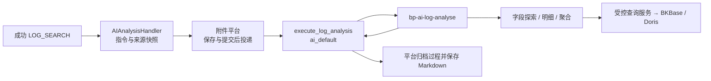

# 日志分析报告接入

AI_ANALYSIS是从成功LOG_SEARCH派生的流式附件。平台负责来源归属、快照、任务和状态；专属Handler/Task负责日志分析业务。公共设计见[模块架构](architecture.md)，前端接入见[报告联调](frontend_log_analysis.md)。

## 1. 业务调用链

任务复用公共Agent Client，以实际用户执行；查询工具每次独立鉴权。分析Agent工具集为audit-log-analysis，统计Agent另用仅含字段探索和聚合的audit-log-statistics；工具路径、配置及能力说明见[查询工具接入](../../query/ai_assistant/README.md)。

## 2. 指令与快照

DEFAULT模式在创建时读取默认指令，CUSTOM模式使用用户指令。有效指令、来源检索条件、轻量查询摘要和用户语言/时区固化到Context；不把日志预览、SQL或结果列作为Agent输入。

来源必须是当前用户可见的成功LOG_SEARCH，并通过输入、上下文和摘要一致性检查。分析使用AgentSearchCondition子集，超出工具条件预算的来源应调整后再创建。默认配置变化不影响已有附件或原样重试；已有附件依赖创建时快照，不因后续编辑来源消息而改写分析范围。

## 3. 过程与产物

Task将Agent事件交给UIStreamRuntime归档与透传，LogAnalysisArtifactExtractor提取闭合assistant消息的完整正文。流关闭后检查正文非空及容量，再返回 `output_data.markdown`；公共Task基类提交终态和尾部过程。

正文按 messageId 收集并在 TEXT_MESSAGE_END 后成为完整候选，不把工具响应或多段中间文字拼成报告。分析提取器保留最后已闭合候选，后续未闭合候选不会被当作完整正文；AI统计采用更严格的末条候选规则，且必须有合法图表标签。两者共用事件提取组件，但不能互换产物判定规则。

RUN_ERROR 会清空此前候选，避免把错误前的说明当作成功报告；后续形成新的完整报告仍可通过校验。网络异常、正文为空或超限按失败链路收敛。SSE收到文字结束或RUN_FINISHED仅表示过程事件，最终状态与产物仍以附件详情为准。

MySQL保存状态、报告与历史过程，Redis只提供实时增量。前端可只轮询详情，也可读取快照后订阅SSE；流结束后读取详情确认终态。流恢复规则见[streaming](../streaming/README.md)。

AI分析保存报告正文，不使用AI统计的图表标签提取。成功报告可完整替换Markdown/HTML，`content_format`标明格式；无标识的旧正文在读取时识别，数据库不迁移。导出复用`core/exporter/report.py`公共渲染器，与风险报告共用模板、字体和PDF分页。HTML清洗后直接渲染，仅在请求Markdown下载时转换；编辑不修改来源快照，导出文件不在平台另存。

## 4. 稳定性

- 任务进入共享ai_default队列；公共Agent Client按Agent Code实施Redis全局限流。队列并发不等于下游配额。
- 业务超时需小于Celery hard limit。HTTP中断、事件解析或产物校验失败走公共失败链路，长期PROCESSING由巡检收敛。
- late ack允许重投，旧任务终态由task_id fencing拒绝；不保证Agent调用只执行一次。
- 人工重试沿用原快照和UID，清空旧产物与过程后建立新执行；SUCCESS和FAILED均可重新生成，处理中的附件不能重复重试。

错误、排队与执行耗时由平台观测。必要执行标识和上游错误正文可记应用日志；对外错误脱敏，指标禁止以用户、任务UID或正文作为高基数标签。详见[可观测性](observability.md)。

## 5. 验证入口

常规测试位于 `tests/test_ai_assistant/test_log_analysis*`。`special/test_log_analysis_e2e.py`通过真实RabbitMQ/gevent Worker、Redis、MySQL及HTTP/SSE验证执行和恢复，Agent上游使用本地模拟服务。部署验证需确认真实工具调用和独立SQL数据对照、最终正文与保存产物一致，以及前端恢复、编辑和下载。Agent效果与程序链路分别评估，不能只根据附件SUCCESS判定报告质量；具体E2E记录留在本地专题。
