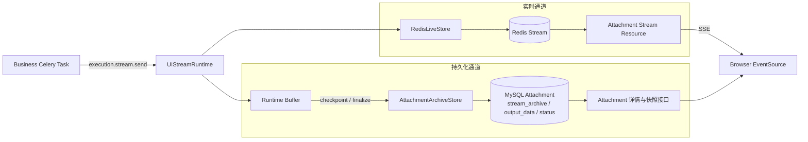
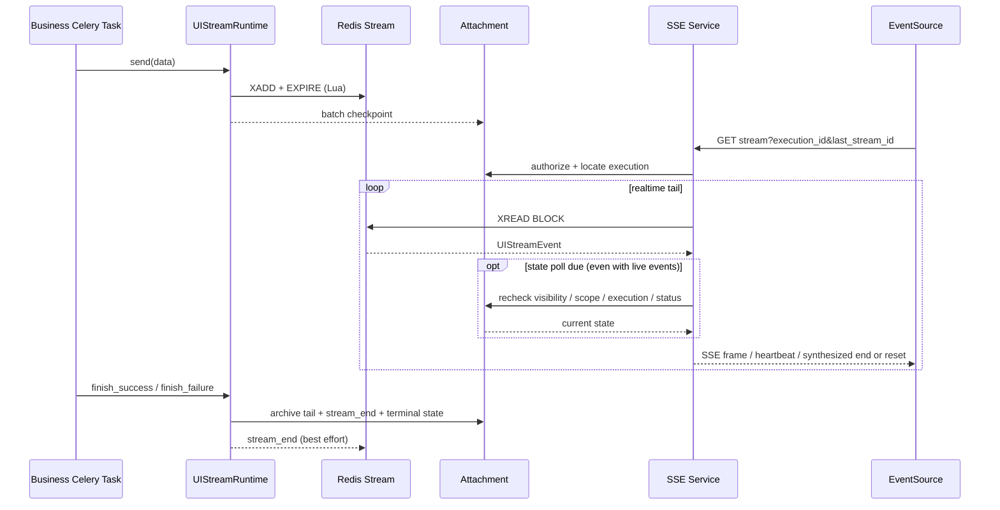
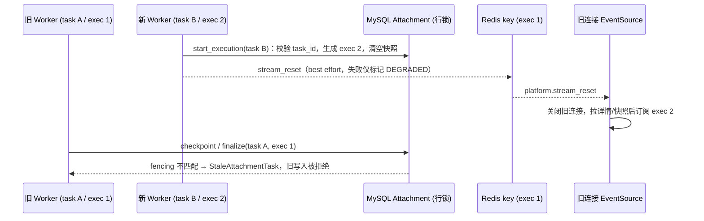

# Attachment UI 流式传输设计

流式子系统为异步 Attachment 提供协议无关的 UI 事件通道。平台负责事件校验、实时推送、快照
归档和最终产物；业务只调用 `execution.stream.send(data)`，`data` 可以承载 AG-UI 或其他
自定义协议。

本文统一说明组件与审计适配层的职责、服务端协议和运行边界。依赖安装与升级见
[依赖维护指南](../../../../docs/ui_stream_dependency.md)，客户端消费步骤见
[前端接入指南](../docs/frontend_integration.md#流式附件先快照再增量最后详情)。

## 1. 架构概览



`UIStreamRuntime` 是业务写入 UI 流的唯一入口。实时通道只解决低延迟推送与短期追赶；持久化通道
保存 UI 快照和最终状态。两条通道允许独立降级，前端通过 SSE 接收增量，通过详情与快照接口恢复
完整可展示状态。

### 1.1 代码地图

| 层 | 位置 | 核心对象 | 本地职责 | 主要测试 |
| --- | --- | --- | --- | --- |
| 写入门面 | `streaming/runtime.py` | `UIStreamRuntime` | 执行轮换与旧流 reset、策略工厂、Trace 与监控摘要 | `test_stream_runtime.py`、`test_stream_policy.py` |
| 持久归档 | `streaming/archive.py` | `AttachmentArchiveStore` | 行锁、双重 fencing、`archive_id` 去重、终态原子提交、超时巡检 | `test_stream_archive.py`、`test_stream_idempotency.py` |
| 实时通道 | `streaming/redis.py` | `RedisLiveStore` | 读写分池、cache key 命名空间、TTL 配置 | `test_stream_redis.py`、`test_stream_transport.py` |
| 事件构造 | `streaming/codec.py` | `archive_codec`、`control_codec` | Runtime 事件身份与归档格式、合成控制事件 | `test_stream_runtime.py`、`test_stream_service.py` |
| 帧编码 | `streaming/sse.py` | `encode_sse_item` | 心跳分支、组件编码异常映射为审计异常，剥离业务正文 | `test_stream_resources.py` |
| 订阅读取 | `services/attachment_stream.py` | `AttachmentStreamService` | 建连校验、周期 `state_check`、DB 连接归还 | `test_stream_service.py` |
| HTTP 出口 | `resources/stream.py` | `GetAttachmentStream`、组件 `SSEBody` | 游标优先级、SSE 响应头、关闭向源迭代器透传 | `test_stream_resources.py`、`test_stream_http_recovery.py` |

以上路径相对 `services/web/ai_assistant/`。通用机制（缓冲、批量、容量裁剪、增量读取循环、帧格式）
由 `ui-stream` 组件提供，边界见[第 9 节](#9-组件边界与扩展契约)。

## 2. 数据流



三份数据职责不同：

- Redis Stream：低延迟实时尾流和短期断线续传，不是事实源；
- `Attachment.stream_archive`：刷新、换端或 Redis 过期后的 UI 快照；
- `Attachment.output_data` 与 `status`：最终产物和业务终态的事实源。

这不是 Redis 与 MySQL 的强一致双写，也不承诺 exactly-once。事件可在 Worker 崩溃的最后一个
checkpoint 窗口内丢失，最终产物仍由 MySQL 终态事务保证。

## 3. 事件模型与传输格式

`UIStreamEvent` 是平台内部统一的**逻辑事件记录**，Redis、MySQL 快照和 SSE 会按各自职责映射，
并不共用同一种 wire format：

```json
{
  "event": "platform.stream_reset",
  "stream_id": "1710000000000-0",
  "data": {"reason": "execution_replaced"}
}
```

- `event`：平台控制事件名称；业务事件固定为 `null`；
- `stream_id`：Redis Stream 增量游标；Redis 写入失败或服务端合成事件时可为空；
- `data`：业务或平台事件负载，必须可编码为标准 JSON，平台不解析业务事件内容。

当前平台控制事件是 `event` 字段的两个枚举值：

- `event="platform.stream_reset"`：当前 execution 被新执行替换，前端关闭旧连接并重新拉取详情和快照；
- `event="platform.stream_end"`：当前 execution 已进入终态，前端关闭连接并拉取最终详情。

业务只调用 `execution.stream.send(data)`，无法指定 `event`，因此平台事件只能由平台产生。

### 3.1 Redis Stream entry

Redis entry 自身的 ID 就是 `stream_id`，所以 entry 的 `payload` 只保存 `event/data`，读取时再将
entry ID 补回逻辑事件：

```json
{"event":"platform.stream_reset","data":{"reason":"execution_replaced"}}
```

### 3.2 MySQL 快照

`Attachment.stream_archive` 和快照接口保存完整的 `event/stream_id/data` 逻辑事件列表，用于刷新、
换端和 Redis 过期后的 UI 恢复。`platform.stream_end` 会随最终状态进入当前 execution 的快照；
`platform.stream_reset` 只通知被替换的旧 Redis Stream，或在 execution 不匹配时由读取服务即时合成，
不保证出现在 MySQL 快照中。

业务事件在进入 pending 前获得内部 `archive_id`，随持久归档保留；公开快照、Redis/SSE 不暴露
该字段。checkpoint 在同一行锁事务内按该身份过滤已提交事件，因此提交成功后 ACK 丢失、
重试重叠 pending 或 Redis 不可用时，也不会重复追加同一身份的事件。不含 `archive_id` 的记录
保留原顺序，不按正文或 Redis 游标去重；相同正文的新事件仍可独立保存。这不是跨 execution
的 exactly-once。

`start_execution`、`checkpoint`、`finalize` 使用 `atomic(durable=True)`，必须在真实外层事务之外调用，
确保方法返回即代表本次数据库提交完成，后续实时发布不会先于可见的持久状态。归档必须使用
内部序列化器保留 `archive_id`；公开 DTO 的序列化结果不能替代持久化格式。

### 3.3 SSE wire format

SSE 把逻辑事件映射为标准 `event/id/data` 文本行，而不是把整个 `UIStreamEvent` 作为 `data`：

```text
event: platform.stream_reset
id: 1710000000000-0
data: {"reason":"execution_replaced"}

```

- 业务事件省略 `event:` 行，由 `EventSource.onmessage` 接收；
- 平台事件输出具名 `event:` 行，前端必须通过 `addEventListener` 监听；
- 只有来自 Redis 的事件输出 `id:`，合成事件不输出，避免客户端续传不存在的游标；
- `data:` 只包含逻辑事件的 `data` 值；浏览器通过 `MessageEvent.data` 读取 JSON 文本，通过
  `MessageEvent.lastEventId` 读取游标。

```javascript
source.onmessage = handleBusinessEvent;
source.addEventListener("platform.stream_reset", handleStreamReset);
source.addEventListener("platform.stream_end", handleStreamEnd);
```

heartbeat 是 `: heartbeat` SSE 注释帧，浏览器会自动忽略；它不是 `UIStreamEvent`，不会写入 Redis
或 MySQL 快照。

## 4. 执行与 fencing

每次实际 Worker 执行调用 `start_execution()`，生成独立 `execution_id` 和 Redis key。
`task_id + execution_id` 构成双重 fencing：

- task ID 隔离用户手动重试产生的新平台任务；
- execution ID 隔离同一 Celery task 的自动 Retry 或 RabbitMQ 重投；
- checkpoint 和 finalize 都在行锁内校验 fencing，旧 Worker 不能覆盖新执行；
- 手动重试排队期间暂存旧配置，新 Worker 启动后向旧流发送 `stream_reset` 并清空旧快照；
- Celery Retry 退出前尽力 checkpoint，不写终态；下一次执行建立新流。

以手动重试为例，新旧执行的交接如下（Celery Retry 同理，只是 task_id 不变、execution_id 变化）：



| 场景 | task_id | execution_id | 被隔离的对象 |
| --- | --- | --- | --- |
| 用户手动重试 | 变化 | 变化 | 旧平台任务的延迟写入 |
| Celery 自动 Retry / RabbitMQ 重投 | 不变 | 变化 | 同一任务上一次执行的延迟写入 |

任务持续执行时，只有成功 checkpoint/touch 会刷新 `last_activity_at`。长期无平台活动的执行由
巡检置为 `FAILED`；若已建立有效流，巡检同时在 MySQL 追加 `stream_end`、将归档标记为
`DEGRADED`，并最佳努力通知 Redis。之后旧 Worker 的 checkpoint/finalize 会被 fencing 拒绝。

## 5. 缓冲与容量

Runtime 默认每 20 条、256KB 或达到活动刷新间隔时 checkpoint。MySQL 故障时保留 pending，
但进程内 pending 同样受 `AI_ASSISTANT_STREAM_ARCHIVE_MAX_BYTES` 限制，达到上限后停止归档并
标记 `TRUNCATED`，避免单任务耗尽 Worker 内存。

独立容量边界（两条通道互不连坐）：

| 边界 | 配置 | 超限后实时通道 | 超限后 MySQL 归档 |
| --- | --- | --- | --- |
| 单事件字节 | `MAX_EVENT_BYTES` | 放弃该事件 | 放弃该事件 |
| 业务事件条数 | `MAX_EVENTS` | 继续 | 停止业务事件归档 |
| Redis 累计字节 | `REDIS_MAX_BYTES` | 停止写入 | 继续 |
| MySQL 归档字节 | `ARCHIVE_MAX_BYTES` | 继续 | 停止业务事件归档 |

终止事件（`stream_end`）和最终 output 不受任何业务容量限制：`finalize` 先按容量追加尾部业务事件，
再以不受容量约束的方式追加终止事件，保证不会出现"有终态但缺终止标记"的快照。配置名省略
`AI_ASSISTANT_STREAM_` 前缀，边界值见 `special/test_stream_capacity.py`。

`stream_archive` 使用 MySQL JSON 整体追加，默认业务归档上限为 10 MiB。checkpoint 会重复
解析和写回历史 JSON，提高上限需要同时评估写放大与事务开销；更大事件量可通过按
execution/sequence 追加的事件块存储扩展，不能只提高 JSON 上限。

## 6. Redis 与 SSE

Redis 使用独立、有界的读/写连接池，仅沿用项目 cache 的地址、认证和 key prefix，不修改
cache/Celery 共享池。固定读/写客户端按部署配置缓存，修改配置需重启；连接池自行处理 fork。
Lua 原子执行 `XADD` 与 `EXPIRE`，每次追加刷新默认 1 小时滑动 TTL；
终态后无新事件，key 自然过期。

SSE 读取流程：

1. 建连时定位本人可见 Attachment、状态和 execution；非法游标或旧代际在读取 Redis 前处理。
2. 非事务环境显式归还健康数据库连接；后续每次状态核对也在 finally 中归还，不在订阅等待期间占用。
3. 默认每 15 秒重新读取可见对象，并检查当前 scope 权限、task/execution 与终态；持续 live
   也执行检查。XREAD BLOCK 按下一次核对的剩余时间收紧，最多 15 秒。
4. 活跃连接发现同 execution 终态时，继续顺序发完已读批次，再非阻塞读尽现有 Redis 尾流；
   原 `stream_end` 存在就透传，真正读空才合成无游标 `stream_end`。全脏 entry 批次仍推进游标。
   执行替换或配置失效则立即合成无游标 `stream_reset` 并关闭；删除、不可见或权限撤销时直接关闭，
   不发送排队旧数据。不补发 MySQL 历史或回灌 Redis；建连时已终态仍沿用原有直接结束协议。

   ```mermaid
   flowchart LR
       POLL["周期 state_check<br/>回读 MySQL + scope 权限"] --> R{结果}
       R -->|None| CONT[继续 XREAD]
       R -->|同代际终态| DRAIN["发完已读批次<br/>非阻塞读尽尾流"] --> END["透传原 stream_end<br/>或合成无游标 stream_end"] --> CLOSE[关闭]
       R -->|代际/配置变化| RESET[合成无游标 stream_reset] --> CLOSE
       R -->|删除/不可见/无权限| CLOSE
   ```
5. 无新事件时发送 heartbeat；仅业务事件刷新默认 300 秒空闲窗口。Redis 故障、控制终止、
   空闲超时、主动关闭或传输异常均结束迭代；响应在开始消费前关闭也会关闭源迭代器。
   HTTP 出口把读取服务返回的同步 iterator 交给组件 `SSEBody`，注入审计编码器；未开始迭代、
   自然耗尽或异常时都能向该 iterator 传递关闭。它不接管外层 iterable，也不保证中断阻塞中的读取
   （由 `test_stream_service.py` 锁定响应生命周期）。
6. 客户端在平台结束、重置、EOF/onerror 后读取详情/快照，只有当前仍 PROCESSING 才考虑重连。

配置定义于 `services/web/settings.py`，设置名可通过同名 `BKAPP_` 前缀环境变量覆盖：

| 设置 | 默认值 | 作用 |
| --- | --- | --- |
| `AI_ASSISTANT_STREAM_TTL` | 3600 秒 | 每次追加刷新 Redis execution key 的 TTL |
| `AI_ASSISTANT_STREAM_MAX_EVENT_BYTES` | 256 KiB | 单个业务事件的实时编码字节上限 |
| `AI_ASSISTANT_STREAM_MAX_EVENTS` | 10000 | 单次执行的业务事件归档条数上限 |
| `AI_ASSISTANT_STREAM_REDIS_MAX_BYTES` | 10 MiB | 单次执行的业务实时写入累计字节上限 |
| `AI_ASSISTANT_STREAM_ARCHIVE_MAX_BYTES` | 10 MiB | 待归档缓冲及持久业务归档的字节上限 |
| `AI_ASSISTANT_STREAM_ACTIVITY_INTERVAL_SECONDS` | 60 秒 | 由业务 send 触发的 checkpoint/touch 间隔 |
| `AI_ASSISTANT_STREAM_IDLE_TIMEOUT` | 300 秒 | SSE 连续无有效业务事件时的空闲窗口 |
| `AI_ASSISTANT_STREAM_STATE_POLL_INTERVAL` | 15 秒 | 订阅中的状态与权限核对周期 |
| `AI_ASSISTANT_STREAM_REDIS_IO_TIMEOUT` | 1 秒 | Redis 建连和写 socket 的有限超时 |
| `AI_ASSISTANT_STREAM_REDIS_WRITE_MAX_CONNECTIONS` | 16 | 每个独立写池的连接上限，池满立即失败 |
| `AI_ASSISTANT_STREAM_REDIS_READ_MAX_CONNECTIONS` | 32 | 每个独立读池的连接上限，池满立即失败 |

Runtime 的 `CHECKPOINT_EVENT_COUNT=20` 和 `CHECKPOINT_BYTES=256*1024` 是批量归档阈值，
不对应环境变量。容量和活动策略在发送时读取当前进程 settings，TTL 在追加时读取；
归档存储还会独立核对持久容量。策略变更不会重置计数或恢复已经停止的通道，归档完整性只单向升级。
环境变量在 Django 加载 settings 时解析，不会自动热加载；修改部署环境需重启相应进程。

读 socket timeout 由 `min(15, STATE_POLL_INTERVAL) + 5` 秒派生，默认仍为 20 秒；
读写分池避免阻塞 XREAD 占满短写池。标准缓存的冷启动并发可能短暂构造额外池，池容量不能当作
严格的进程连接配额。这里只约束 Redis 在途命令；应用层未限制存活 SSE 数量，也未提供慢接收者
发送截止。宿主与代理需要结合副本数、客户端数、事件速率和大小配置并发限制与发送截止；
Gunicorn 的普通 worker timeout/keepalive 不等价于每次发送截止。
15 秒是正常 I/O 下的状态核对周期，不是故障恢复 SLO：数据库/权限查询耗时和网络故障仍会影响
收敛时间，Redis 黑洞按读 socket timeout 结束。终态通知不是事实源，最终结果始终以详情为准。

## 7. 失败矩阵

| 故障 | 实时流 | MySQL 快照 | 最终产物 |
| --- | --- | --- | --- |
| Redis 写失败 | 停止或缺失部分事件 | 继续，状态 `DEGRADED` | 继续执行 |
| checkpoint 短暂失败 | 已发布事件仍可见 | pending 后续重试 | 继续执行 |
| checkpoint 持续失败 | 可继续至 Redis 上限 | pending 达上限后 `TRUNCATED` | 继续执行 |
| finalize 数据库失败 | 不能确认终态 | 保留 pending | 由业务 Celery 重试策略决定 |
| terminal Redis 发布失败 | 周期核对持久终态后合成 `stream_end` 并关闭 | 已含 `stream_end` | 已提交 |
| Worker 永久退出 | Redis 保留已发送事件至 TTL | 最后 checkpoint 前缀，巡检标记 `DEGRADED` | 巡检置为 `FAILED` |
| Redis key 过期 | 无法继续追赶 | 快照仍可读取 | 不受影响 |

日志、Metric、Event 和 Trace 都不得包含业务 `data` 正文。流降级只影响 UI 过程完整性，不应
直接把成功最终产物改为失败。

## 8. 测试入口

- `test_stream_runtime.py`：缓冲、容量、降级和终态；
- `test_stream_policy.py`：策略工厂延迟求值、每次 send 读取一次、终态/重试路径不求值；
- `test_stream_archive.py`：MySQL 行锁、fencing、快照解析；
- `test_stream_idempotency.py`：`archive_id` 身份、pending 重叠幂等追加、内部字段计入容量但不公开；
- `test_stream_schemas.py`：事件模型、平台事件保留名、严格 JSON 与配置序列化；
- `test_stream_redis.py` / `test_stream_resources.py`：Redis 协议和 SSE 服务；
- `test_stream_service.py`：正常/终态跨批顺序、代际/可见性核对、DB 释放与 response/source 关闭；
- `test_stream_transport.py`：固定读写池、有限超时、真实 loopback Redis 黑洞和池满失败；
- `test_stream_http_recovery.py`：真实 ORM + `resource.request()` + loopback HTTP 编码/解析，
  live port 使用受控故障替身，覆盖丢终态/reset 后读取持久详情或新快照；
- `test_http_integration.py`：真实 HTTP StreamingResponse；
- `special/test_sse_e2e.py`、`test_stream_concurrency.py`、`test_stream_failures.py`：真实 Redis、
  RabbitMQ、Celery Worker 的端到端、并发和故障场景；
- `special/test_stream_capacity.py`：四类容量边界的等于/超出一字节场景。

## 9. 组件边界与扩展契约

`ui-stream[redis]` 提供不依赖 Django、DRF、Celery 或审计模型的通用流处理能力；审计通过
下列适配点接入。组件安装、版本与依赖维护统一见[依赖维护指南](../../../../docs/ui_stream_dependency.md)。

| 入口 | 组件负责 | 审计负责 |
| --- | --- | --- |
| `UIStreamRuntime` | 缓冲、容量、串行发送、归档协调与关闭通知 | 当前 settings、事件编解码、业务异常、执行轮换与监控 |
| `RedisLiveStore` | Lua追加/TTL、增量读取和脏entry处理 | 独立连接池、cache命名空间、事件模型和TTL配置 |
| `AttachmentArchiveStore` | 按身份去重、容量裁剪、追加/重复/丢弃计数与完整性合并 | MySQL事务、双重fencing、身份与字节计量、终态容量豁免、快照与最终结果 |
| `AttachmentStreamService` | 游标、心跳、空闲窗口与终态排空循环 | state_check中的可见性、scope权限、持久状态与代际核对、DB连接归还 |
| SSE编码适配 | 标准event/id/data帧、heartbeat和同步iterator关闭 | 将组件编码异常映射为审计公开异常，组装响应头 |

Runtime 通过 `policy=self._build_policy` 显式注入无参配置工厂，公共 `policy` 属性由组件解析。
工厂只读取当前进程 settings 与批量阈值，不执行 I/O 或驱动生命周期；组件在每次 send 的锁内
取得一份策略快照，finish/close_for_retry 不重新读取。
策略字段只接受非负内置 int，拒绝 bool、数值子类、浮点数与字符串；零值保留各字段语义，
不是统一的禁用开关：零实时字节停止业务实时发布，零条数停止归档，零批量或活动阈值逐条检查。

业务 Handler 只声明 `is_stream=True` 并发送可编码的 `data`；平台 Task 负责创建 Runtime、
轮换执行和收敛终态，业务不自行构造Redis key、控制事件或重复提交结果。

适配器须遵守以下契约：

- 事件在接受后按只读值使用。Redis回执返回含游标的新事件，归档身份保持不变；严格JSON校验
  错误属于接入错误，应向调用方暴露，不能当作传输故障吞掉。
- 执行轮换提交后，通过 `announce_replacement` 向旧发布器发送 `reset`；配置的 Redis/OSError/
  LiveUnavailable 故障仅降级新 Runtime 并由组件记录新执行上下文，事件构造、编码及其他异常继续传播。
- `append_archive_events` 在行锁内按 `archive_id` 去重并按内部编码计量；截断日志分别记录新增、重复和
  容量丢弃数量。无身份旧记录仍保留；终态在审计的 fencing/CAS 事务中直接追加，不受业务容量限制。
- `checkpoint` 返回后才可清空pending；`commit` 只有在尾部、终止事件与业务结果已原子提交后返回。
  `AttachmentCompletion` 只携带结果及审计字段，业务状态由平台终止事件提供。
- `state_check` 在首次迭代、读取 Redis 前执行，此后按周期核对；不替代建连前的请求鉴权。
  返回 `None` 表示仍可继续；返回end时非阻塞排空同代际尾流，返回reset时立即切断旧流。
  可见性或权限异常由宿主关闭连接，不发送排队旧数据。组件不查询审计模型或代替宿主鉴权。
- `close_for_retry` 只尝试 checkpoint 并关闭当前 Runtime，不写业务终态、不调度任务，也不确认
  进度已持久化；配置内归档故障降级后仍会关闭，未配置的错误继续向宿主传播。
- 策略、编码和存储回调不得重入同一 Runtime 的写入口。重入异常原样传播；若已进入可能写入的
  端口则同时标记 DEGRADED，表示结果不确定，不证明数据丢失，也不自动重发。
- 实时字节预算仅计发布端成功返回的回执；不是实际网络字节硬上限。摘要业务计数仍按接受事件
  计量，不等于已发布或已归档的数量。
- `after_close` 接收不可变摘要，在锁外执行；监控失败不能使已提交的业务结果回滚或被重试。
  日志和摘要不包含事件data正文。
- Redis逻辑key只由适配器通过 `cache.make_key` 映射一次；请求关闭不释放共享客户端池。
  若替换存储或传输实现，仍须保持独立execution、fencing、容量和关闭语义。

当前能力提供当前执行的快照与实时尾流，不提供历史执行查询、完整事件重放或业务取消。
