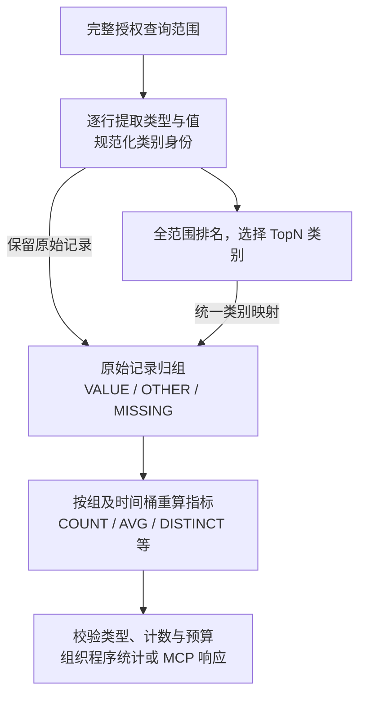

# 日志查询与统计实现

本目录提供字段探索、脱敏明细、通用聚合和程序字段统计。附件执行见[AI 助手架构](../../../ai_assistant/docs/architecture.md)，页面接入见[统计联调](../../../ai_assistant/docs/frontend_statistics.md)。

## 1. 模块边界

| 能力 | 主要文件 | 职责 |
| --- | --- | --- |
| 可信上下文与字段权限 | `context.py`、`sensitive.py` | 校验用户、系统、条件和字段权限，解析真实数据表 |
| 字段探索 | `field_metadata.py`、`field_definitions.py` | 内置声明优先，样本补充动态路径与类型提示 |
| 明细查询 | `search.py`、`sql.py` | 查询补列、逐行脱敏、最终投影 |
| 字段表达式 | `statistics_fields.py` | 生成类型与原生值的 SQL 表达式 |
| 统计 SQL | `statistics_sql.py` | 全范围规范化、TopN、原记录归组和聚合 |
| 结果与预算 | `statistics_result.py`、`statistics_budget.py`、`statistics_summary.py`、`statistics_types.py` | 时间规划、类型恢复、摘要及完整性校验 |
| 消费者 | `aggregation.py`、`statistics.py` | 分别组织 MCP 结果与程序统计固定包 |

## 2. 查询与权限

查询上下文来自当前用户、租户和检索条件，调用方不能传任意表或 SQL。系统授权写入查询条件；过滤、排序、维度和指标涉及的敏感路径在查询前检查。

详情和采样先补齐脱敏所需身份列，再经 SearchDataParser 脱敏，最后投影；辅助列不对外输出。聚合直接拒绝无权字段，不能先计算后遮罩。

过滤会泄露命中数，排序会泄露顺序，聚合会泄露分布，因此这些计算字段必须在查询前鉴权，不能靠返回后脱敏补救。父对象探索可能包含有权与无权子字段，采用逐行脱敏后发现路径，再清除无权字段的样例与统计能力；不会因为其中一个子字段无权就拒绝整个对象。

查询经 SafeQuerySyncResource 使用裸表 ID 与 `prefer_storage="doris"`，SQL 同时兼容 BKBase 前置解析和 Doris。明细数据/count 使用同一条件批量查询，但不承诺两条SQL的事务快照一致性。

## 3. 字段发现与类型

根目录来自内置配置，无需采样。下钻将声明子字段与最多100条脱敏样本合并：声明优先保留类型和别名，动态字段由样本发现。Web 级联模式在同一批样本上返回后代叶子的完整路径；MCP 保持单层探索，每次最多50字段。

内置子字段无样本时仍保留并标记 DECLARED，动态路径标记 INFERRED；样本补充观察类型、样例和覆盖率，不覆盖声明。Web 递归只遍历这一批数据，不按每个子节点再次查 Doris，不展开数组。声明解析集中在 `field_definitions.py`，目录、明细列和统计标题共用别名。

字段目录与实际统计使用不同的类型依据：

| 阶段 | 类型从哪里来 | 用途 |
| --- | --- | --- |
| 根字段及内置子字段目录 | 服务端字段配置 | 展示别名、类型与能力提示，不是动态读取 Doris 表结构 |
| 动态子字段目录 | 脱敏样本中观察到的 JSON 值 | 帮助选择字段；不能证明全范围类型一致 |
| 实际统计 | 普通列按服务端声明；JSON/VARIANT 子路径用 JSON_TYPE、JSON_EXTRACT_* 逐行读取 | 在完整范围检查类型并计算结果 |

`source_columns()` 只生成最后一行所需的类型和值表达式，实际执行在 Doris 内，不是再次采样。已知合法 JSON 路径可直接统计；不能用样本目录是否包含该路径作为执行门槛。

类别身份为“类型＋规范值”：数字1与1.0合并，与字符串"1"区分；布尔保留类型；null/缺失归MISSING，空字符串是实际值。去重使用单列类型前缀键，兼容Doris多个DISTINCT指标。对象/数组及不安全数值不能隐入OTHER。

路径能力校验在日志查询模块统一复用，不影响其他业务；JSONPath编码放在通用查询构造层。含单引号的原始key通过 `CONCAT(...,CHAR(39),...)` 构造路径，避免BKBase重写字符串转义后读取错误；普通路径仍使用字面量。统计、明细、导出和父字段采样共用这套编码，不裁剪或改写key。不支持的key在请求边界拒绝，探索跳过并标记truncated。

目录options沿用原枚举展示，但不限制实际合法输入值；Collector结果码-1仅匹配真实-1，非零应使用neq/exclude 0。

## 4. 统计核心算法

MCP TopN在完整范围选定，所有时间桶复用同一组类别；程序全量模式复用相同排名和原记录归组，保留所有真实类别，不构造OTHER。OTHER的AVG、DISTINCT_COUNT和近似分位数必须在映射后的原始记录上重算，不能合并已有摘要。缺失不占TopN名额。

例如完整范围有 GET 3 条、POST 2 条、PUT 1 条、DELETE 1 条、缺失 1 条，Top2 选中 GET 和 POST。两小时结果如下，时间桶沿用全范围图例：

| 结果组 | 完整范围 | 10:00 | 11:00 |
| --- | ---: | ---: | ---: |
| GET（VALUE） | 3 | 2 | 1 |
| POST（VALUE） | 2 | 1 | 1 |
| OTHER（PUT + DELETE） | 2 | 1 | 1 |
| MISSING | 1 | 1 | 0 |

直接 GROUP BY 后 LIMIT 只能截断类别，不能得到上述 OTHER，也不能保证每个时间桶的类别一致。OTHER 的平均值同样不能取“各类别平均值的平均”：1 条值为100、9条值为0的记录合并后均值为10，而不是50。去重数也必须在合并后的原记录上计算。

最终SQL重新计算分组、时序、转换质量和可选数值摘要；预检只用于类别数及时间预算规划，不拼接为最终统计。纯时间ALL组数已知，跳过类别预检。CTE表示逻辑步骤，不保证Doris仅扫描一次。

结果通过META/GROUP/ROW/QUALITY/SUMMARY帧传输，标量显式走STRING通道，再恢复数字、字符串和布尔，避免 UNION 和查询平台统一列类型时改变原始值。解析器检查帧、类别、总数、时序与摘要一致性，不返回截断的成功结果。

普通数值指标保留原生数值域；字符串/JSON数值运算按LONG/DOUBLE显式转换，失败值排除并计入data_quality。输入原生数值和最终数值均校验安全范围与类型；不以输出舍入修复精度损失。

### 查询引擎兼容约束

SQL 必须同时通过 BKBase 前置解析和 Doris 执行，维护时保留以下构造约束；本地 SQL 解析通过不代表平台能执行。

| 构造方式 | 设计原因 |
| --- | --- |
| JSON/VARIANT 共用 JSON_TYPE、JSON_EXTRACT_* | 不依赖高版本 VARIANT_TYPE；按实际值保留布尔、数字等类型 |
| DISTINCT_COUNT 使用类型前缀的单列键 | 避免多个多列 DISTINCT 同查被拒绝，同时区分数字与字符串；缺失排除、空字符串保留 |
| 帧内部使用 frame_key；元信息用单行 CTE 关联 | 避开 key 保留字，以及 CAST 内标量子查询的解析限制 |
| 时间桶用毫秒差除法后 FLOOR | 避免前置解析拒绝 DIV，保持实际时间定位 |

表路由和单引号路径编码见前文；这些规则应由共享构造层维护，各消费者不要复制 SQL 修补分支。

## 5. 时间与结果组织

MCP默认Top10，OTHER/MISSING额外返回；程序统计返回全部类别，只保留实际MISSING。时间轴支持分钟/小时/天/自然月，按可信时区划分，首尾桶只计原始闭区间范围。二者的AUTO统一从月到分钟选择首个实际桶数达到阈值的粒度，默认12桶，可通过 `BKAPP_AI_LOG_STATISTICS_AUTO_MIN_BUCKETS` 配置；均不足时用分钟，再独立检查容量。预算限制类别/桶/单元与响应字节，部署配置可收紧。

输入时间、SQL分区及桶轴共用 `time_range.parse_log_time`：无时区字符串按服务端默认时区解释，显式偏移保留真实时刻后再规范化给 Collector。分钟/小时沿 UTC 时间线推进，日桶按本地日历推进，避免偏移或夏令时造成重复解释。结果用返回的 timezone 展示。

数值单元预算按“组数 × 桶数 × 预算列数”估算：程序统计每桶只有计数列，按1列计算；MCP按指标数加2列计算，包含辅助计数与比例。字节预算仍单独检查，减少 TopN 或加粗时间粒度不能保证任意长文本结果不超限。AUTO 与显式粒度超限均明确报错，不静默改粒度重查；具体容量配置见 `statistics_budget.py` 和 `services/web/settings.py`，不把保护上限当作压测承诺。

| 消费者 | 输出与语义 |
| --- | --- |
| FieldStatisticsService | 概览、分布、完整时序；声明数值列或全范围存在值均为原生数字时增加数值摘要，中位数近似 |
| LogAggregationService / MCP | columns、rows、groups、query_summary、data_quality；支持自定义维度及指标，时序只返回有日志的稀疏桶 |

程序统计补齐空桶，计数为0；无有效数值的指标为null。比例、数值摘要及聚合浮点指标统一输出四位小数，整数计数与类别原值不舍入。小比例舍入为0时是否有日志以计数为准。

## 6. 变更与验证

类别名称由statistics_labels.py复用FieldMapHandler，程序groups和MCP groups.values附value_label，动态子路径不套根枚举，名称不参与身份或SQL。程序全量与MCP TopN使用同一最终META/GROUP/ROW/SUMMARY快照。

新增字段/指标需同时核对协议、权限、类型、OTHER重算、预算和结果解析；新消费者复用内核，不引入ECharts协议。测试位于 `tests/test_query/test_ai_assistant/`；程序附件测试位于 `tests/test_ai_assistant/`。SQL构造单测不替代实际BKBase查询验证；字段统计、MCP聚合、明细和导出需在同一范围对照独立SQL，导出还需解析实际文件。受控只读CTE可补充不存在的特殊键样本，但不代表部署Worker已处理真实非空业务数据。
